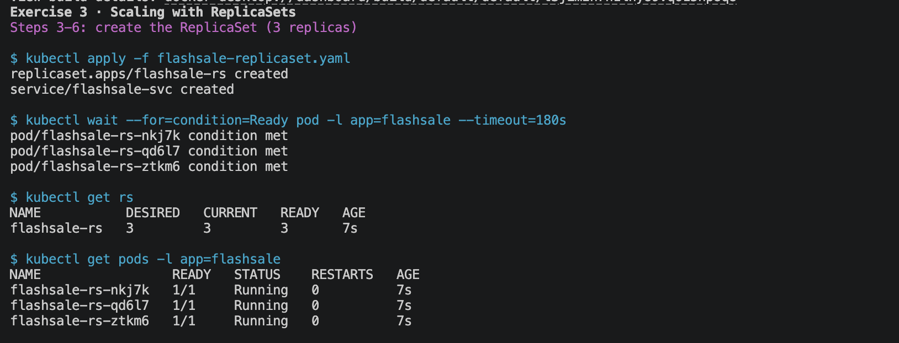
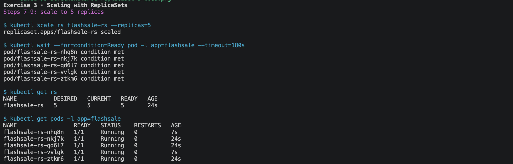
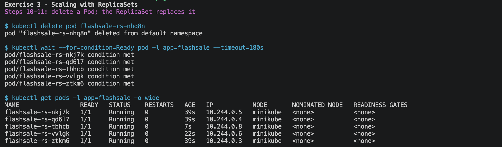

# Exercise 3: Scaling a Flask App on a Single Node with ReplicaSets

Original: [Exercises/3-Minikube-Scaling-Flask-App-with-Replicasets.md](https://github.com/SunagP/DevOps-Lab/blob/main/Exercises/3-Minikube-Scaling-Flask-App-with-Replicasets.md)

## What it does

A "flash sale" Flask app (`/`, `/buy`, `/health`) runs under gunicorn. A
`ReplicaSet` keeps 3 copies running, with readiness/liveness probes on
`/health`, behind a `ClusterIP` Service. You scale to 5, delete a Pod and watch
it come back, and check that requests are spread across Pods (`served_by_pod`).

## Prerequisites

- Docker running, plus `kubectl` and `minikube` (`setup/verify.sh`)
- Optional: a Docker Hub account, only if you want to push the image

## Files

| File | Purpose |
|---|---|
| `app.py` | Flash-sale Flask app |
| `requirements.txt` | Flask, Werkzeug, gunicorn (pinned) |
| `Dockerfile` | Image `flashsale:1.0` served by gunicorn on :5000 |
| `flashsale-replicaset.yaml` | ReplicaSet (3 replicas) + `flashsale-svc` Service |

## Run it

Run everything from this folder.

```bash
# Step 1: start fresh (skip the delete if you want to keep an existing cluster)
minikube stop; minikube delete

# Step 2: single-node cluster
minikube start --nodes=1 --container-runtime=docker
kubectl get nodes

# Build the image INSIDE Minikube, BEFORE applying the ReplicaSet
eval $(minikube docker-env)
docker build -t flashsale:1.0 .

# Steps 3-4: create the ReplicaSet and Service
kubectl apply -f flashsale-replicaset.yaml

# Step 6: verify (wait until all 3 are READY 1/1)
kubectl get pods -l app=flashsale
kubectl get rs

# Steps 7-9: scale to 5
kubectl scale rs flashsale-rs --replicas=5
kubectl get rs
kubectl get pods -l app=flashsale

# Steps 10-11: delete one Pod and watch the ReplicaSet replace it
POD=$(kubectl get pods -l app=flashsale -o jsonpath='{.items[0].metadata.name}')
kubectl delete pod "$POD"
kubectl get pods -l app=flashsale -o wide     # still 5, one is brand new

# See load distribution: 10 /buy requests from inside the cluster.
# Look at "served_by_pod" in each response.
kubectl run load --rm -it --restart=Never --image=curlimages/curl:8.17.0 -- \
  sh -c 'for i in $(seq 1 10); do curl -s http://flashsale-svc/buy; echo; done'
```

Optional: push to Docker Hub (needs `docker login`). Set `DOCKERHUB_USERNAME`
in your root `.env` first:

```bash
set -a; source ../.env; set +a
docker tag flashsale:1.0 "$DOCKERHUB_USERNAME/flashsale:1.0"
docker push "$DOCKERHUB_USERNAME/flashsale:1.0"
```

## Cleanup

```bash
kubectl delete -f flashsale-replicaset.yaml
eval $(minikube docker-env -u)
minikube stop        # or: minikube delete
```

## Screenshots

Capture these from **your own run** and save them in [`screenshots/`](screenshots/) with these names:

| File | What to capture |
|---|---|
| `screenshots/01-replicaset-3-pods.png` | `kubectl get rs` and `kubectl get pods` with 3 Pods Running |
| `screenshots/02-scaled-to-5.png` | After `kubectl scale rs flashsale-rs --replicas=5`: 5 Pods |
| `screenshots/03-self-healing.png` | After deleting a Pod: still 5, one with a new name/low AGE |
| `screenshots/04-load-distribution.png` | The `kubectl run load ...` output showing different `served_by_pod` values |

### My run

**Steps 3–6: ReplicaSet created, 3 Pods Running**



**Steps 7–9: scaled to 5 replicas**



**Steps 10–11: deleted Pod replaced automatically**



**Requests spread across Pods (`served_by_pod`)**


## Changes from the original / gotchas

The original exercise doesn't work as written:

1. **Wrong filename in the Dockerfile:** `COPY ex3-flash-sale.py .`, but
   gunicorn loads `app:app`, so the container crashes with
   `ModuleNotFoundError: No module named 'app'`. Fixed: `COPY app.py .`.
2. **Image name mismatch:** the ReplicaSet uses `flashsale:1.0`, but Step 5
   builds `flask-app`. Fixed: build `flashsale:1.0`.
3. **Wrong order:** the original applies the ReplicaSet (Step 4) *before*
   building the image (Step 5). Here the build comes first.
4. **No `imagePullPolicy`:** without it Kubernetes tries to pull
   `docker.io/library/flashsale:1.0`, which doesn't exist (`ErrImagePull`).
   Added `imagePullPolicy: Never` to use the locally built image.
5. **Wrong resource name:** Steps 6–11 use `flask-app-rs`; the ReplicaSet is
   `flashsale-rs`. Commands fixed.
6. **Pinned deps:** `pip install flask gunicorn` → `requirements.txt`.
7. **ClusterIP Service** isn't reachable from your laptop, so the `kubectl run
   load ...` command tests it from inside the cluster.
   `kubectl port-forward svc/flashsale-svc 8080:80` also works, but it always
   hits one Pod, so you won't see the distribution.
8. **`eval $(minikube docker-env)` needs the Docker runtime.** Recent Minikube
   clusters may run containerd, and then `docker build` fails with
   `failed to inspect pulled image moby/buildkit ... 404 page not found`.
   Start with `--container-runtime=docker`. An existing cluster keeps its
   runtime, so if `minikube profile list` says `containerd`, run
   `minikube delete` first. (`./lab.sh` does this check for you.)
