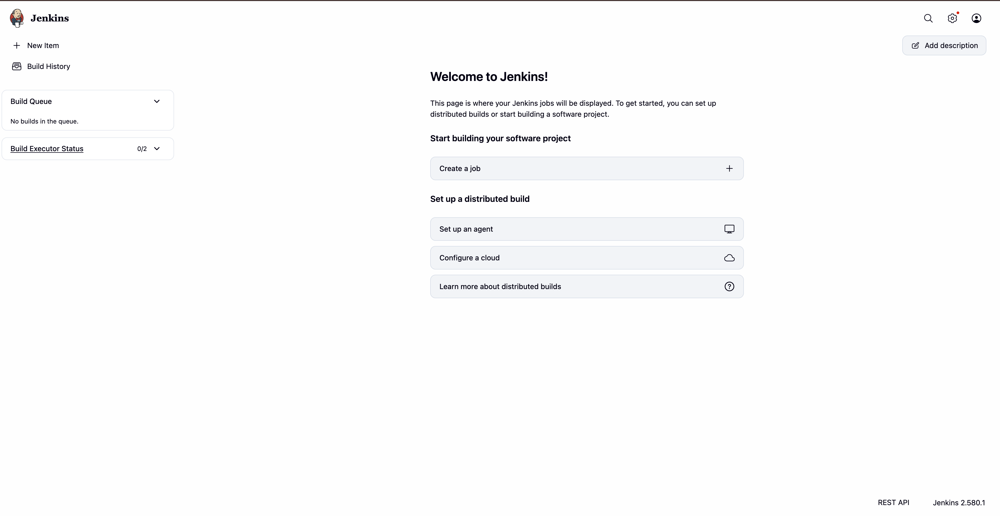

# Exercise 7: Introduction to CI and Jenkins Installation

Original: [Exercises/7-Jenkins-CI-Automation.md](https://github.com/SunagP/DevOps-Lab/blob/main/Exercises/7-Jenkins-CI-Automation.md)

## What it does

Covers what Continuous Integration is (frequent integration, automated builds
and tests, fast feedback), surveys CI tools (GitLab CI, CircleCI, GitHub
Actions, …), and gets Jenkins running in Docker with the initial admin unlock.

The second half of the original ("Creating Hello World Jenkins Job": create
`hello-world.sh`, push it to GitHub) continues in
[`../08-jenkins-hello-world`](../08-jenkins-hello-world/README.md).

## Prerequisites

- Docker running (`setup/verify.sh`)
- About 2 GB of free RAM for Jenkins

## Run it

From the repo root:

```bash
jenkins/run-jenkins.sh
```

This builds the lab Jenkins image (Jenkins LTS plus docker CLI, python3, git;
see [`../jenkins/README.md`](../jenkins/README.md) for why), starts the
`jenkins` container on ports 8080/50000, and prints the initial admin password.

1. Open <http://localhost:8080>.
2. **Unlock Jenkins:** paste the password the script printed. You can get it
   again with:
   ```bash
   docker exec jenkins cat /var/jenkins_home/secrets/initialAdminPassword
   ```
3. **Customize Jenkins:** choose **Install suggested plugins** (includes Git and Pipeline).
4. **Create First Admin User:** pick your own username and password. Don't
   store them in this repo.
5. **Instance Configuration:** keep `http://localhost:8080/` → Save and Finish.

Check that it's healthy:

```bash
docker ps --filter name=jenkins
docker logs --tail 20 jenkins
```

## Cleanup

Leave Jenkins running if you're continuing to Exercises 8, 9 or 6. Otherwise:

```bash
docker stop jenkins                 # pause (keeps jobs)
docker rm -f jenkins                # remove container; jobs stay in volume jenkins_home
docker volume rm jenkins_home       # wipe everything
```

## Screenshots

Capture these from **your own run** and save them in [`screenshots/`](screenshots/) with these names:

| File | What to capture |
|---|---|
| `screenshots/01-jenkins-unlock.png` | The Unlock Jenkins page |
| `screenshots/02-jenkins-dashboard.png` | Jenkins dashboard after setup, logged in as your admin user |

### My run

**Jenkins 2.580.1 set up and running**



## Changes from the original / gotchas

- `docker run ... jenkins/jenkins:lts` → `jenkins/run-jenkins.sh` (pinned
  LTS image with the tools Exercises 6 and 9 need, plus a `jenkins_home`
  volume so your jobs survive container restarts).
- The original links to `urmsandeep/DevOps-Lab-Manual` and `urmsandeep/DevOps`
  for "Getting started with Jenkins". Those are the same steps as above.
